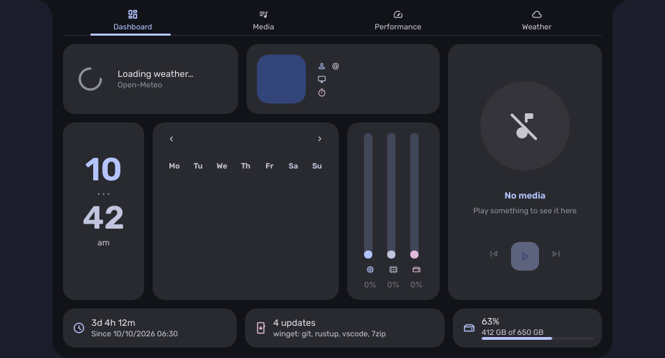
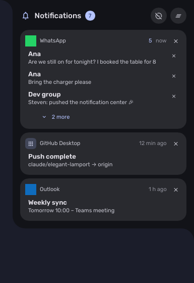
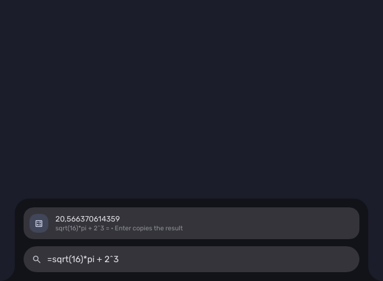
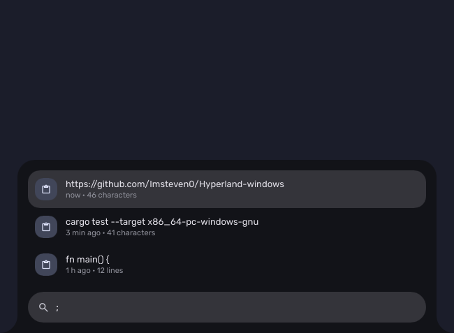

# Caelestia for Windows

A desktop shell for Windows inspired by [Caelestia](https://github.com/caelestia-dots/shell),
the Hyprland shell: a vertical bar with workspaces, a screen frame, and drawers
that grow out of it (dashboard, launcher, utilities, session, notifications),
all coloured from your wallpaper with Material You. Written in Rust with
[Slint](https://slint.dev). It reads the same `shell.json` as Caelestia, so
dots can be shared between Linux and Windows.

[](https://github.com/Imsteven0/Hyperland-windows/actions/workflows/ci.yml)
[](LICENSE)

[Leer en español](README.es.md)

| Dashboard | Notification center |
|-----------|---------------------|
|  |  |

| Launcher: calculator | Launcher: clipboard history | Workspace switch |
|----------------------|-----------------------------|------------------|
|  |  |  |

## Features

- **Bar** on every monitor: workspaces with their app icons (Windows virtual
  desktops, or komorebi workspaces), active window, clock, status icons with
  popouts (audio, network, Bluetooth, battery, calendar) and a notification bell.
- **Dashboard**: weather, calendar, media controls with cover art, CPU/GPU/RAM/disk
  and network graphs, plus your own plugin widgets.
- **Launcher** (`Alt+Space`, or the Windows key): fuzzy app search and
  - `>` actions (wallpaper, schemes with live preview, light/dark, power…),
  - `=` calculator (`=sqrt(16)*pi`, `=90deg`, decimal comma or point),
  - `:` emoji picker in English or Spanish (`:fire`, `:fuego`),
  - `;` clipboard history (memory only; password managers are skipped).
- **Notification center**: what Windows keeps in its Action Center, grouped by
  app, with Do Not Disturb.
- **Utilities**: keep awake, screenshots, recordings, quick toggles, performance mode.
- **Themes**: dynamic Material You schemes from the wallpaper (9 variants) or
  presets (Catppuccin, Gruvbox, Nord…), transparency and blur.
- **Wallpapers**: carousel with live preview, and downloads from any GitHub repository.
- **Dots gallery**: import someone's configuration from a GitHub link, with undo.
- **Plugins**: dashboard or bar widgets defined by a `plugin.json` and a
  command or script ([examples](examples/plugins)).
- **Performance mode**: no blur, animations or edge hover on battery or while a
  full-screen game or video is in front.
- **Tiling** with [komorebi](https://github.com/LGUG2Z/komorebi), themed from the scheme.
- English and Spanish UI.

## Install

Requires 64-bit Windows 10 (version 2004 or newer) or Windows 11.

> **Tiling needs komorebi.** Caelestia is the bar, frame and drawers; the
> tiling window manager is [komorebi](https://github.com/LGUG2Z/komorebi)
> (developed and tested with 0.1.41), installed separately:
>
> ```powershell
> winget install LGUG2Z.komorebi
> ```
>
> Then turn on **Use komorebi for tiling** in Settings › Panels › Tiling. Caelestia
> starts and themes it for you (see [Tiling with komorebi](#tiling-with-komorebi)).
> Without komorebi the shell still works, using Windows virtual desktops as workspaces.

**Installer (recommended)**: download `caelestia-win-<version>-setup.exe` from
[Releases](https://github.com/Imsteven0/Hyperland-windows/releases) and run it.
No admin rights are needed: it installs for your user in
`%LOCALAPPDATA%\Programs\Caelestia` and starts with Windows (turn that off in
Settings › Panels › Startup). Running a newer installer updates in place and
keeps your dots.

**Portable**: unzip `caelestia-win-<version>-x64.zip` anywhere and run `caelestia.exe`.

**Scoop**:

```powershell
scoop install https://github.com/Imsteven0/Hyperland-windows/releases/latest/download/caelestia.json
```

> **"Windows protected your PC"**: until the releases are code-signed,
> SmartScreen may warn the first time. Choose **More info → Run anyway**. Each
> release lists SHA-256 checksums in `SHA256SUMS.txt` so you can verify the
> download (`Get-FileHash <file>`).

Settings › About tells you when a new version is out (it checks GitHub once a
day; set `general.checkUpdates` to `false` to turn that off).

### From source

Needs [Rust](https://rustup.rs) 1.92 or newer and the MSVC build tools.

```powershell
git clone https://github.com/Imsteven0/Hyperland-windows
cd Hyperland-windows
powershell -ExecutionPolicy Bypass -File scripts\install.ps1   # builds and installs per user
```

## Shortcuts

| Shortcut | Action |
|----------|--------|
| `Alt+Space` (or the Windows key, see Settings › Panels) | Launcher |
| `Ctrl+Alt+D` | Dashboard |
| `Ctrl+Alt+U` | Utilities |
| `Ctrl+Alt+N` | Notification center |
| `Ctrl+Alt+P` | Session (lock, sleep, restart…) |
| `Ctrl+Alt+S` | Settings |
| Hover the top edge / bottom-right corner | Dashboard / utilities |

In the launcher: `↑ ↓` or `Tab` to move, `Enter` to run or copy, `Esc` to close,
`Shift+Del` removes a clipboard entry. Change any shortcut in `windows.shortcuts`;
`calc`, `emoji` and `clipboard` can open the launcher straight in that mode.

From a terminal (or a script), the running shell can be driven with:

```text
caelestia toggle launcher|dashboard|utilities|session|sidebar|settings
caelestia launcher calc|emoji|clipboard
caelestia dashboard 0|1|2|3        (overview, media, performance, weather)
caelestia settings 0..9            (open a Settings page)
caelestia picker scheme|variant|opacity
caelestia reload | quit
```

## Tiling with komorebi

Caelestia draws the bar, frame and drawers; [komorebi](https://github.com/LGUG2Z/komorebi)
can tile your windows. Caelestia writes the visual part of `komorebi.json` (gaps,
borders in your scheme's colours, animations) and never starts komorebi's own bar
or hotkey daemon.

1. Install it: `winget install LGUG2Z.komorebi` (free for personal use), or use
   the **Install komorebi** button in Settings › Panels › Tiling.
2. Turn on **Use komorebi for tiling** there. The bar then shows komorebi's
   workspaces per monitor.

| Shortcut | Action |
|----------|--------|
| `Alt+H/J/K/L` | Focus left/down/up/right |
| `Alt+Shift+H/J/K/L` | Move the window |
| `Alt+1..8` | Go to workspace |
| `Alt+Shift+1..8` / `Alt+Ctrl+1..8` | Move the window there and follow / send it |
| `Alt+T` · `Alt+Shift+F` · `Alt+Shift+M` | Float · monocle · maximise |
| `Alt+Q` · `Alt+M` | Close · minimise |
| `Alt+X` / `Alt+Y` · `Alt+,` / `Alt+.` | Flip · cycle layout |
| `Alt+Plus` / `Alt+Minus` (with `Shift`: vertical) | Resize |
| `Alt+O` / `Alt+Shift+O` | Next monitor / move there |
| `Alt+P` · `Alt+Shift+R` | Pause tiling · retile |

Your own binds go in `windows.komorebi.binds` (`{ "Alt+H": "focus left" }`) and
replace the defaults.

## Configuration

Everything lives in `%USERPROFILE%\.config\caelestia\shell.json` (Caelestia's
format; unknown keys are kept). The file is hot-reloaded and most options are in
Settings. Add the schema for autocompletion and validation in VS Code:

```json
{ "$schema": "https://raw.githubusercontent.com/Imsteven0/Hyperland-windows/main/schema/shell.schema.json" }
```

- **Share your dots**: Settings › About › Export dots. **Use someone's**: paste
  their GitHub link in **Dots gallery** (your paths, language, location and
  startup settings are kept, nothing that runs commands is imported, and
  **Undo import** restores your previous dots).
- **Notifications**: allow *Notification access* for apps in
  Windows Settings › Privacy & security › Notifications.
- **Plugins**: see [examples/plugins](examples/plugins/README.md).
- **Logs**: `%LOCALAPPDATA%\caelestia\shell.log`.

## Development

```powershell
cargo run            # debug build with a console
cargo test           # unit tests (translations, schema, config, launcher...)
cargo test -- --ignored --skip downloads_a_folder   # tests that need a desktop session
```

UI strings use `@tr()`; add the Spanish text to
`translations/es/LC_MESSAGES/caelestia-win.po` (a test fails otherwise). CI builds
and tests every push; pushing a `v*` tag publishes a release with the installer.
See [packaging/README.md](packaging/README.md) for releases, signing and winget.

## License

[GPL-3.0](LICENSE), like Caelestia, whose design and configuration format this
project follows. Bundled fonts and libraries keep their own licenses: see
[THIRD_PARTY.md](THIRD_PARTY.md).

Created by [Steven Araya Gonzalez](https://github.com/Imsteven0). Based on
[Caelestia](https://github.com/caelestia-dots/shell) by the caelestia-dots project.
